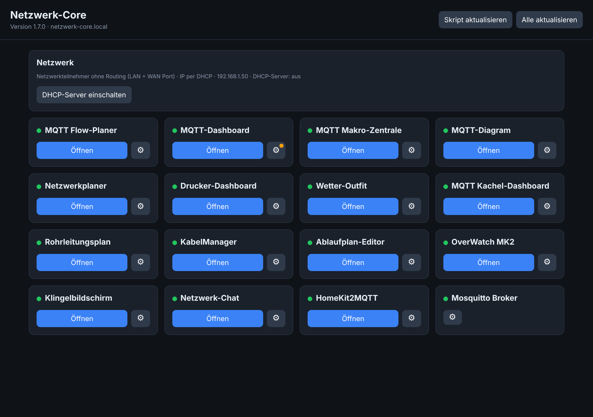
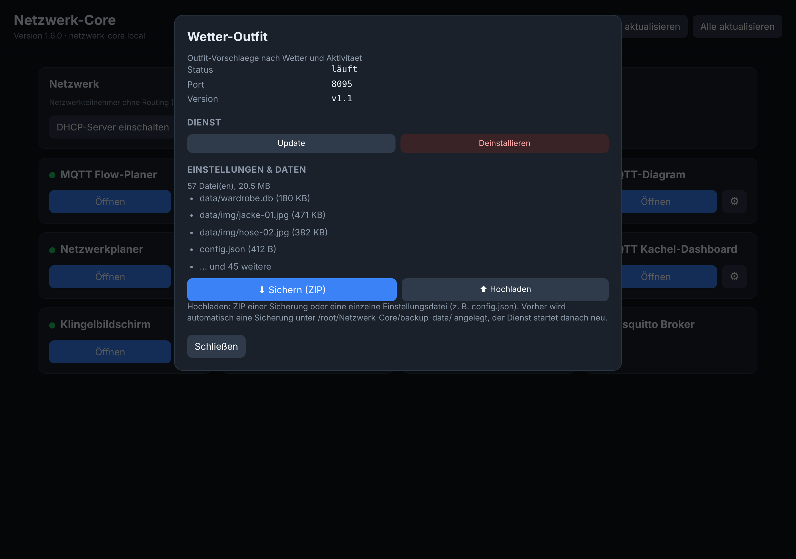
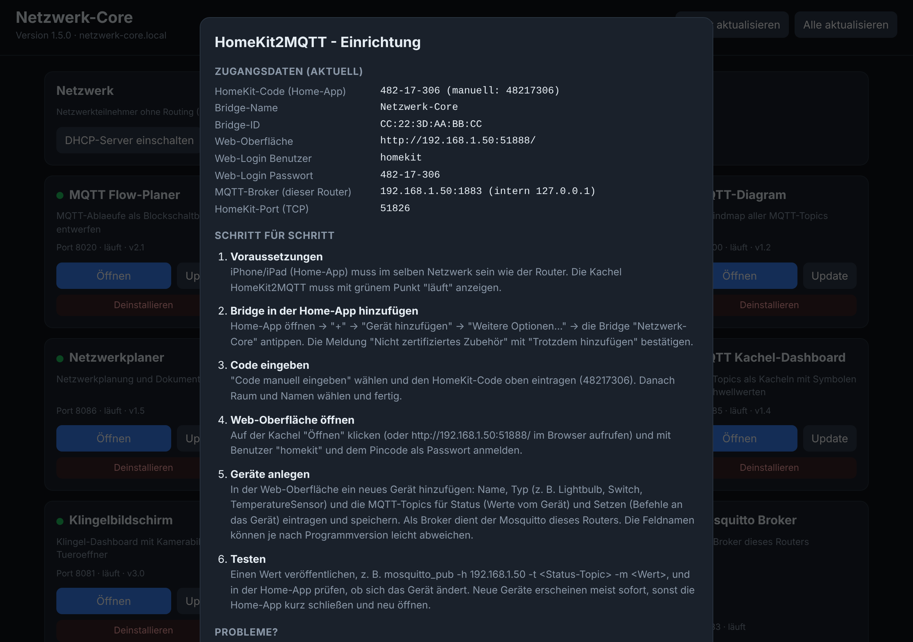

# Network-Core-MK1

Ein-Klick-Einrichtung für einen **GL.iNet Brume 2 (GL-MT2500, OpenWrt)**: Das Skript installiert alle Programme, richtet den Autostart ein und stellt die Statusseite **„Netzwerk-Core“** bereit – mit Kacheln, Statusanzeige, Versionsnummer und Update-Buttons.



## Was wird installiert?

- `nano`, `mosquitto` (MQTT-Broker, Port 1883)
- 15 Anwendungen aus GitHub, jeweils mit Autostart (procd)
- die Statusseite **Netzwerk-Core** auf Port **8090**

| Anwendung | Port |
|---|---|
| MQTT Flow-Planer | 8020 |
| MQTT-Dashboard (MK4) | 5001 |
| MQTT Makro-Zentrale | 8010 |
| MQTT-Diagram | 5000 |
| Netzwerkplaner | 8086 (nicht 8080: dort läuft die Router-Oberfläche) |
| Drucker-Dashboard (BambuLab MK6) | 8000 |
| Wetter-Outfit | 8095 |
| MQTT Kachel-Dashboard | 8085 |
| Klingelbildschirm (MK3) | 8081 / 8082 (Anzeigen), 8083 (Einrichtung, Button *Öffnen*) |
| Rohrleitungsplan | 8087 |
| KabelManager | 8088 |
| Ablaufplan-Editor | 8089 |
| OverWatch MK2 (ohne SMS-Modem) | 8094 |
| Netzwerk-Chat | 8092 |
| HomeKit2MQTT | 51888 (HomeKit 51826) |

## Installation

Router per SSH erreichen (`ssh root@192.168.8.1`), Skript auf den Router kopieren und einmal ausführen:

```sh
scp -O -r netzwerk-core-install.sh root@192.168.8.1:/root/
ssh root@192.168.8.1 "sh /root/netzwerk-core-install.sh"
```

Der Schalter `-O` ist beim Brume 2 nötig: Neuere `scp`-Versionen übertragen per SFTP, das der Router (Dropbear) nicht anbietet. Mit `-O` nutzt `scp` das klassische Protokoll.

Der Router braucht dafür Internet. Fehlt es, setzt sich die Installation beim nächsten Start automatisch fort. Das Log liegt unter `/root/Netzwerk-Core/install.log`.

Danach ist die Statusseite unter `http://<Router-IP>:8090/` erreichbar.

## Netzwerkmodus

Am Ende stellt das Skript den Router auf **Netzwerkteilnehmer ohne Routing** um: LAN- und WAN-Port liegen in einer Bridge, die IP kommt per DHCP, der eigene DHCP-Server ist aus.

- Neue IP: in der DHCP-Liste des Hauptrouters nachsehen (Hostname `GL-MT2500`).
- Notfalladresse (falls kein DHCP-Server im Netz ist): `192.168.8.1` (bzw. `192.168.88.1`, wenn das Uplink-Netz 192.168.8.x ist).
- DHCP-Server einschalten: Button auf der Statusseite oder `sh /root/Netzwerk-Core/bin/nc-network.sh dhcp-on`.
- Umstellung überspringen: `NC_SKIP_NETWORK=1 sh netzwerk-core-install.sh`
- Originalzustand wiederherstellen: `sh /root/Netzwerk-Core/bin/nc-network.sh restore`

## Updates

- **Anwendungen:** Button *Update* im Einstellungsfenster der Kachel (⚙) bzw. *Alle aktualisieren* oben. Die Apps werden aus ihren GitHub-Repos neu geladen, Einstellungen und Daten bleiben erhalten. Das Badge *Update verfügbar* erscheint, sobald ein neuer Stand im Repo liegt.
- **Dieses Skript:** Button *Skript aktualisieren* lädt die neueste `netzwerk-core-install.sh` aus diesem Repo und führt sie im Update-Modus aus. Erneuert werden Hilfsskripte, Statusseite und App-Liste (eigene Einträge in `apps.conf` bleiben erhalten); neue Apps werden nachinstalliert. Netzwerk, Mosquitto und App-Daten bleiben unberührt. Bei einem Fehler erfolgt ein automatischer Rollback (Sicherung unter `/root/Netzwerk-Core/backup-core/`). Das Badge *Skript-Update … verfügbar* erscheint, wenn die Versionsnummer `NC_VERSION` auf GitHub höher ist.

> Die Versionen vor 1.4.0 kennen den Update-Modus noch nicht: Einmalig die neue Version manuell ausführen, danach geht es per Button.

Manuell im Update-Modus: `NC_SELF_UPDATE=1 sh netzwerk-core-install.sh`

## Einstellungsfenster je Dienst

Jede kompakte Kachel zeigt nur Name, Status und den Button *Öffnen*. Alles Weitere steckt im Einstellungsfenster (Zahnrad ⚙, ein orangefarbener Punkt zeigt ein verfügbares Update an): Status, Port, Version, *Update/Installieren*, *Deinstallieren*, *Hilfe* (nur HomeKit2MQTT) sowie Sichern und Einspielen der Einstellungen und Daten.



### Einstellungen und Daten sichern / einspielen

- **Sichern (ZIP):** lädt alle Einstellungs- und Datendateien des Dienstes als ZIP herunter, z. B. `config.json`, Datenbanken, Ordner `data/` und hochgeladene Bilder (beim Wetter-Outfit die Kleidungs-Datenbank samt Bildern, bei HomeKit2MQTT auch die Kopplungsdaten, beim Klingelbildschirm die `config.ini`). Das ZIP kann Zugangsdaten (z. B. MQTT-Passwörter) enthalten und sollte entsprechend aufbewahrt werden.
- **Hochladen:** spielt ein solches ZIP oder eine einzelne Einstellungsdatei (z. B. `config.json`) ein. Vorher legt der Netzwerk-Core automatisch eine Sicherung unter `/root/Netzwerk-Core/backup-data/` an (die letzten 3 je Dienst), danach startet der Dienst neu. Ein ZIP eines anderen Dienstes wird abgelehnt, Programmdateien werden nie überschrieben.
- Hinweis: Welche Dateien als Daten gelten, merkt sich der Netzwerk-Core beim Installieren/Aktualisieren eines Dienstes. Bei bereits installierten Diensten ist die Erkennung nach dem nächsten *Update* am genauesten; Standard-Dateien (`config.json`, `*.db`, `data/`, `uploads/` …) werden immer erkannt.

### Deinstallieren und Hilfe

- **Deinstallieren:** Im Einstellungsfenster. Autostart und Dienst werden entfernt; auf Wunsch werden auch Einstellungen und Daten gelöscht (sonst bleiben sie für eine spätere Neuinstallation erhalten). Deinstallierte Dienste werden von *Alle aktualisieren* und beim Skript-Update nicht wieder installiert; mit *Installieren* auf der Kachel kommen sie zurück.
- **HomeKit2MQTT-Hilfe:** Im Einstellungsfenster gibt es einen Button *Hilfe* mit der Einrichtung Schritt für Schritt und den aktuellen Zugangsdaten (HomeKit-Code, Bridge-ID, Web-Login, Ports).



## Neue Anwendung hinzufügen

Eine Zeile in `/root/Netzwerk-Core/apps.conf` ergänzen (Format steht in der Kopfzeile der Datei) und auf der Statusseite *Installieren* klicken. Private Repos: GitHub-Token in `/root/Netzwerk-Core/github_token` ablegen.

## Verzeichnisse

| Pfad | Inhalt |
|---|---|
| `/root/Netzwerk-Core/apps/` | die installierten Anwendungen |
| `/root/Netzwerk-Core/bin/` | Hilfsskripte und Statusseite |
| `/root/Netzwerk-Core/apps.conf` | App-Liste |
| `/root/Netzwerk-Core/update.log`, `install.log` | Protokolle |

## Fehlersuche

```sh
cat /root/Netzwerk-Core/install.log
logread | grep nc-
/etc/init.d/nc-<id> restart
```
